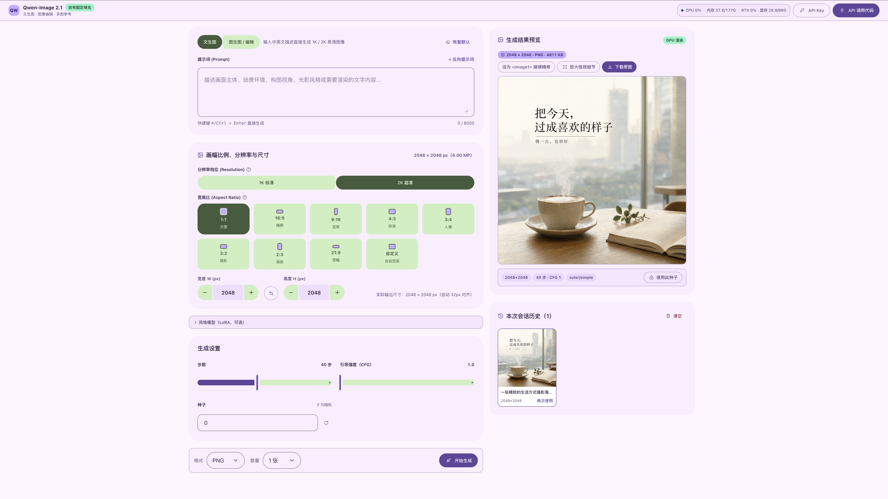

# Colab

在 Colab 运行图像、视频、语音和对话模型。选择对应笔记本，启动后打开页面即可使用。

| 模型 | 建议显存 | 简介 | 一键打开 |
| --- | --- | --- | --- |
| [Qwen-Image 2.1](notebooks/qwen-image-2.1/Qwen_Image_2.1.ipynb) | 80GB+ | 文生图、图像编辑、多图参考 | [](https://colab.research.google.com/github/boltguo/colab/blob/main/notebooks/qwen-image-2.1/Qwen_Image_2.1.ipynb) |
| [MiniMax-H3](notebooks/minimax-h3/MiniMaxH3.ipynb) | 80GB+ | 有声视频、首尾帧、多模态参考 | [](https://colab.research.google.com/github/boltguo/colab/blob/main/notebooks/minimax-h3/MiniMaxH3.ipynb) |
| [SeedVR2](notebooks/seedvr2/SeedVR2.ipynb) | 40GB+ | 视频和图片放大、细节修复 | [](https://colab.research.google.com/github/boltguo/colab/blob/main/notebooks/seedvr2/SeedVR2.ipynb) |
| [IndexTTS 2.5](notebooks/indextts-2.5/IndexTTS_2.5.ipynb) | 40GB+ | 音色克隆、语速和情绪控制 | [](https://colab.research.google.com/github/boltguo/colab/blob/main/notebooks/indextts-2.5/IndexTTS_2.5.ipynb) |
| [Qwen3.8-27B](notebooks/qwen3.8-27b/Qwen3.8_27B.ipynb) | 40GB+（FP8）/ 80GB+（BF16） | 对话、深度思考、图片与视频理解 | [](https://colab.research.google.com/github/boltguo/colab/blob/main/notebooks/qwen3.8-27b/Qwen3.8_27B.ipynb) |

以上按本仓库的笔记本配置选择 GPU，实际显存用量随分辨率、视频长度和上下文长度变化。每个笔记本独立运行一个模型。

## Web 页面

上传素材、填写文本或提示词，再调整尺寸、步数、种子等常用设置。底部选择输出格式和数量，点击生成；结果可以预览、下载，也可以从本次历史中再次使用。

专业采样、缓存、推理精度和编码细节使用默认值。页面右上角可查看机器资源、设置 API Key 和复制调用代码。



## API 调用

使用对应笔记本启动后生成的服务地址。页面右上角「API 调用代码」可直接复制当前设置，`/docs` 可查看完整接口和参数。

图像、视频、语音和超分通过 `POST /api/v1/generate` 提交任务，返回 `task_id` 后查询结果。以 IndexTTS 为例：

```python
import time
import requests
from urllib.parse import urljoin

BASE_URL = "https://YOUR_TUNNEL_DOMAIN"
API_KEY = "YOUR_API_KEY"  # 登录网页后，在右上角 API Key 中设置
headers = {"Authorization": f"Bearer {API_KEY}"} if API_KEY else {}

response = requests.post(
    f"{BASE_URL}/api/v1/generate",
    headers=headers,
    json={"text": "你好，欢迎收听。", "speaker_audio": "preset:ref_audio"},
    timeout=30,
)
response.raise_for_status()
task = response.json()

while task["status"] not in {"succeeded", "failed", "cancelled"}:
    time.sleep(1)
    response = requests.get(
        f"{BASE_URL}/api/v1/tasks/{task['task_id']}", headers=headers, timeout=30
    )
    response.raise_for_status()
    task = response.json()

if task["status"] != "succeeded":
    raise RuntimeError(task.get("error") or task["status"])
print(urljoin(BASE_URL, task["result"]["audio_url"]))
```

自定义素材先上传到 `POST /api/v1/files`，再将返回的 `file_id` 填入对应输入字段。需要实时进度时连接 `WS /api/v1/tasks/{task_id}/ws`。

Qwen3.8-27B 提供 OpenAI 兼容的 `/v1/chat/completions` 和 Anthropic 兼容的 `/v1/messages`。例如：

```bash
curl "https://YOUR_TUNNEL_DOMAIN/v1/chat/completions" \
  -H "Content-Type: application/json" \
  -H "Authorization: Bearer YOUR_API_KEY" \
  -d '{"model":"qwen3.8-27b","messages":[{"role":"user","content":"你好"}]}'
```

应用访问密码与 API Key 独立。API 默认免鉴权；在网页右上角设置 API Key 后，外部调用才需要携带它。留空保存可关闭 API 鉴权，修改立即生效。高级参数仍可通过 API 使用。

## 使用说明

1. 从上方选择模型，连接符合要求的 Colab GPU。
2. 依次运行笔记本的四步；第 4 步在 `ACCESS_PASSWORD` 填写应用访问密码，也可在 Colab Secrets 配置同名项。
3. 打开最后一步输出的链接，输入密码后上传素材或填写文本。需要外部调用时，再在网页右上角设置 API Key。
4. 使用默认设置先生成一次，再按需要调整尺寸、时长、步数或种子。

Quick Tunnel 的临时地址随实例停止而失效。需要固定域名时，在第 4 步选择自有 Cloudflare Tunnel，并配置 `CF_TUNNEL_TOKEN`。

## 模型与功能

### Qwen-Image 2.1

支持文生图和图像编辑，最多使用 10 张参考图。可以选择 1K / 2K、画幅比例或自定义尺寸，一次生成 1～4 张；编辑结果支持与原图对比、继续精修。

### MiniMax-H3

支持文生视频、首尾帧和图片/视频/音频参考，最多 9 张参考图，混合素材合计最多 12 份。当前提供 540p / 768p；极速模式会自动选择推荐步数。

### SeedVR2

上传视频或图片，选择按倍数或目标尺寸放大。7B Sharp 偏重清晰度，3B Fast 偏重速度；视频可保留原声，结果支持放大前后对比。

### IndexTTS 2.5

使用内置 Sage 音色，或上传、录制自己的参考人声。支持中文、英语、日语、西班牙语和阿拉伯语，可调整语速、描述语气或使用情绪参考音频。

### Qwen3.8-27B

支持文字、图片和视频对话，可开关深度思考、设置回复长度和随机程度。也可接入兼容 OpenAI / Anthropic 接口的客户端。

### 挂载 LoRA

在 Qwen-Image 或 MiniMax 中展开「风格模型（LoRA，可选）」：选择已有模型、粘贴模型链接，或上传本地 `.safetensors` 文件。启用后调整强度，再正常生成即可；多个模型可以叠加使用。

<details>
<summary>本地开发与更新</summary>

本地开发使用 Python 3.12、Node.js 22.18+、pnpm 11；媒体处理需要 FFmpeg。

```bash
pnpm -C frontend install --frozen-lockfile
pnpm -C frontend build:all
python3 -m pip install -r backend/requirements.txt
python3 backend/run_server.py --feature indextts-2.5 --mock
```

`--mock` 用于检查界面和调用流程。真实推理需要对应权重和 GPU。

Colab 从 GitHub Releases 安装预构建应用。源码更新后，运行 GitHub Actions 的 **Build & Publish Feature App Releases** 发布新版本并同步笔记本，再使用最新笔记本运行安装与启动步骤。

</details>

## 许可

代码采用 [Apache-2.0](LICENSE)。模型权重请遵循各项目许可证：[Qwen-Image](https://huggingface.co/Qwen/Qwen-Image-2.1/blob/main/LICENSE)、[MiniMax-H3](https://huggingface.co/Comfy-Org/MiniMax-H3)、[SeedVR2](https://huggingface.co/Comfy-Org/SeedVR2)、[IndexTTS](https://huggingface.co/IndexTeam/IndexTTS-2.5)、[Qwen3.8](https://huggingface.co/Qwen/Qwen3.8-27B)。
